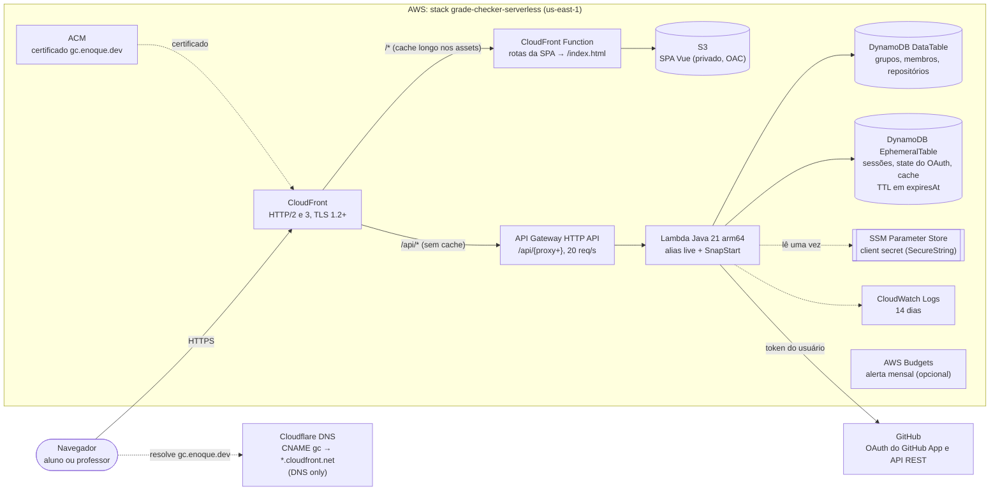
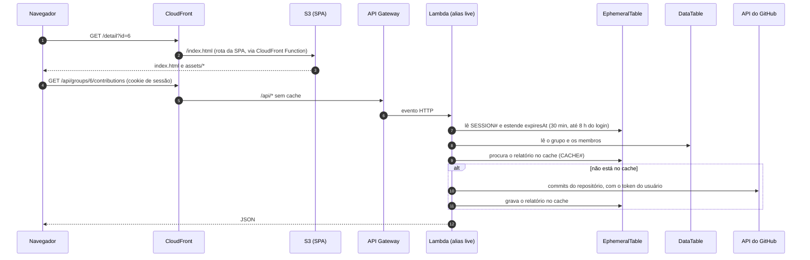
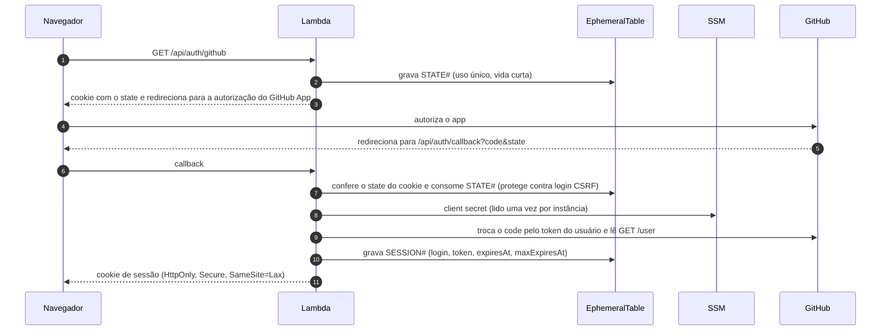
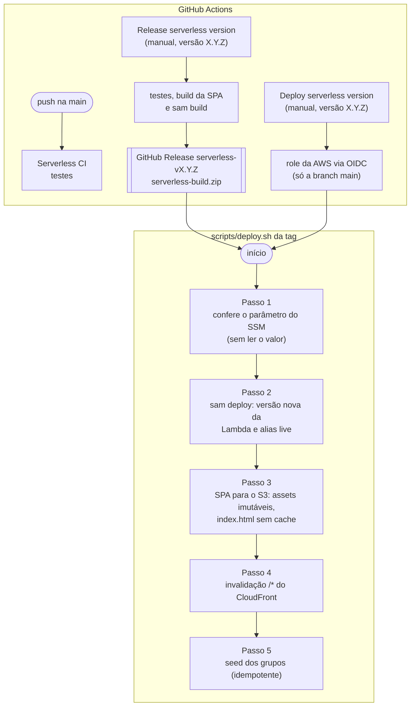

# Arquitetura AWS (versão serverless)

A versão serverless (`applications/serverless`) roda numa única stack do CloudFormation, `grade-checker-serverless`, em `us-east-1`, descrita em [`template.yaml`](../applications/serverless/template.yaml) (AWS SAM). A aplicação responde em `https://gc.enoque.dev`; o domínio `*.cloudfront.net` da distribuição também funciona.

Um único domínio serve a SPA e a API: o CloudFront manda `/api/*` para o API Gateway e todo o resto para o bucket S3. Por isso não há CORS, e o cookie de sessão é do mesmo site.

## Visão geral

## Recursos

| Recurso | Tipo | Papel |
|---|---|---|
| `Distribution` | CloudFront | Porta de entrada. `/*` vai para o S3, com o cache gerenciado *CachingOptimized*. `/api/*` vai para o API Gateway sem cache (*CachingDisabled*), repassando cookies, query e headers, menos o `Host`. Redireciona HTTP para HTTPS, usa `PriceClass_100` e aceita IPv6. |
| `SpaRewriteFunction` | CloudFront Function | No *viewer request*, troca caminhos sem extensão (`/home`, `/detail`…) e os antigos `.jsp` por `/index.html`, para o roteador da SPA resolver. |
| `SpaBucket` + `SpaOriginAccessControl` + `SpaBucketPolicy` | S3 + OAC | Arquivos da SPA. O bucket é privado e criptografado: só esta distribuição lê (assinatura SigV4 pelo OAC). |
| `HttpApi` | API Gateway (HTTP API) | Rota `ANY /api/{proxy+}` para a Lambda, com limite de 20 requisições por segundo (rajada de 40). |
| `ApiFunction` | Lambda | API inteira em Java 21 (arm64, 1024 MB, 29 s). O API Gateway chama o alias `live`; cada versão publicada ganha um snapshot do SnapStart, que encurta a partida a frio. |
| `ApiFunctionLogGroup` | CloudWatch Logs | Logs da função, guardados por 14 dias. |
| `DataTable` | DynamoDB (sob demanda) | Dados permanentes, numa tabela única (`PK`/`SK`): grupos (`GROUP#`), membros (`MEMBER#`), repositórios (`REPO#`) e apelidos de autor (`ALIAS#`). Tem recuperação para um ponto no tempo (PITR). |
| `EphemeralTable` | DynamoDB (sob demanda) | Dados de vida curta, apagados pelo TTL do DynamoDB em `expiresAt`: sessões (`SESSION#`), `state` do login OAuth (`STATE#`) e o segundo nível do cache dos relatórios (`CACHE#`). |
| Parâmetro do SSM | SSM Parameter Store | O client secret do GitHub App (`/grade-checker/github-client-secret`), criado à mão uma vez e fora da stack. A função só tem permissão de ler esse parâmetro. |
| Certificado | ACM | Certificado de `gc.enoque.dev`, pedido uma vez, fora da stack, com validação por DNS no Cloudflare. |
| `Budget` | AWS Budgets | Orçamento mensal com alerta por e-mail. Só é criado quando `BUDGET_EMAIL` é informado. |

Todos os recursos recebem as tags `Application=grade-checker`, `Component=serverless`, `Environment`, `ManagedBy=cloudformation` e `Repository`, usadas para separar o custo no Cost Explorer.

## Fluxo de uma requisição

O cache dos relatórios tem dois níveis: primeiro a memória da instância da Lambda e depois a `EphemeralTable`, que é compartilhada entre as instâncias.

## Login com o GitHub

O token do GitHub fica só no DynamoDB, nunca no navegador. O navegador guarda apenas o identificador da sessão, num cookie que o JavaScript não lê.

## Release e deploy

O deploy não usa chaves da AWS guardadas no GitHub: o workflow assume uma role por OIDC, e essa role só aceita a branch `main` deste repositório. A role é criada uma vez, à parte, pela stack [`github-oidc.yaml`](../applications/serverless/github-oidc.yaml).

O deploy publica o mesmo build que a Release testou. Ele só publica uma versão nova da Lambda, e move o alias `live`, quando o código ou a configuração mudam. Detalhes e variáveis estão no [README da serverless](../applications/serverless/README.md).

## Segurança

- **Sem servidor exposto:** o bucket é privado e só o CloudFront lê os arquivos da SPA. O endereço `execute-api` do API Gateway também é público, mas exige a mesma sessão que o domínio da aplicação, então não abre outro caminho para os dados.
- **Segredo fora do código e da stack:** o client secret fica numa SecureString do SSM e a Lambda só pode ler esse parâmetro. O `deploy.sh` confere que ele existe sem ler o valor.
- **Permissões mínimas:** a função só lê e grava as duas tabelas da stack e lê o parâmetro do SSM. A role do deploy só alcança recursos com o prefixo da stack.
- **Sessão:** vence depois de 30 minutos sem uso e, mesmo com uso, 8 horas depois do login (a vida do token do GitHub App). Os prazos são configuráveis em `SESSION_IDLE_MINUTES` e `SESSION_MAX_HOURS`.
- **Abuso e custo:** limite de 20 requisições por segundo no API Gateway, concorrência reservada opcional (`MAX_CONCURRENCY`) e orçamento mensal com alerta (`BUDGET_EMAIL`).
